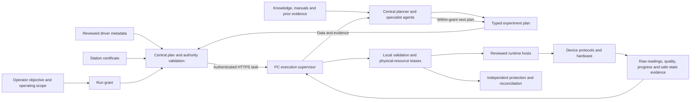

# LabOS: reusable device capabilities and bounded experiment plans

Status: implementation proposal grounded in the current source, 2026-11-01. The companion onboarding guide is implemented as documentation. The registry, certificates, plan compiler, discovery CLI and generic execution below are proposed interfaces, not deployed capabilities. The current finite physical experiment continues on its separately reviewed extension.

## Problem and immediate direction

Changing a point list must become a new validated plan, with a new task identity, rather than a software release. Adding a protocol operation or changing a driver/protection implementation remains a software/qualification change. Today both cases cross several hardcoded schemas. The five-to-nine-point change exposed that coupling directly.

Two narrow workstreams address different delays: a bounded plan compiler around the working field executor removes release-per-scan overhead; reusable driver packages and a read-only scalar device prove onboarding beyond the optical assembly. Neither requires replacing the whole runtime at once.

## Source audit

| Boundary | Verified current behavior | Migration seam |
| --- | --- | --- |
| Core0.2.8 generic Agent | `agent.py:27` constructs only simulated instruments; `models.py:34` admits laser/rotator/spectrometer; `runtime.py:164` loops wavelength/angle; `files.py:84` validates spectra | Keep the demo API compatible; introduce a separately versioned capability/data path |
| Physical core0.2.8 | `PilotEngine` takes an injected adapter; cleanup/proof expects its optical-specific methods | Put the existing strict optical proof behind a named trusted station policy |
| Candidate0.2.9rc1 | `pilot_authority.py:39–60` contains the cited laser/0.004V completion proof; this file is absent from live0.2.8 | Migrate both local and central boundaries deliberately; do not treat staged code as deployed |
| Field extension0.1.1 | Task schema accepts exact5/9 paths; magnetic adapter separately admits a fixed target set | Replace both restrictions with one envelope validator; retain separate transition/settling guards |
| SDK isolation | The field extension already runs the magnetic SDK in a child and latches uncertainty on timeout | Extend that pattern to reusable runtime hosts |
| Ownership | Generic IDs and station-config-path leases can alias the same physical instrument | Bind leases to a commissioned canonical physical-resource set |

## The four records

| Record | Describes | Does not grant |
| --- | --- | --- |
| `DriverPackage` | Reviewed implementation, operations, supported models, units, lifecycle effects, dependency/runtime/SDK digests, simulator and stop-policy implementations | Permission to control a particular PC, sample or address |
| `StationCertificate` | Observed identities, canonical resources/aliases, wiring/terminal roles, calibration, tested operations, station limits and hazard evidence | Unlimited use of everything the upstream driver supports |
| `RunGrant` | Allowed operation subset, sample limits, time/point/travel budgets, expiry, owner and commissioned references | New protocol operations or changed protection code |
| `ExecutionPlan` | Template version plus typed parameters, explicit ordered coordinates, observation/stability requirements and final disposition | Raw code/SCPI, arbitrary expressions or an enlarged grant |

Effective authority is the intersection of package capabilities, station qualification, sample constraints and the current grant. The plan may narrow that intersection. Central validates metadata without importing vendor/plugin code; the PC validates it again and resolves only the already installed reviewed implementation.

Certificates and grants must be registered through a trusted issuer/authorization path. A digest detects a changed file; it does not prove who approved it. Keep evidence basis explicit: source inspection, operator-confirmed wiring and live readbacks are different claims. Known wiring/sample changes require the corresponding renewed binding or sample grant; software cannot independently infer every cable connection.

An execution-journal record is separate from these four authoring records. Before adapter construction, consume one durable, non-replayable attempt identity bound to task/plan/grant and physical resources. Lost receipts, restart, permission/session expiry, profile/package changes and delivery retries do not mint another attempt. Retain uncertain ownership until reviewed reconciliation; a new task ID cannot be used as an automatic retry of an ambiguous physical action.

Separate execution/dependency/SDK/binding/protection digests from unrelated editorial documentation revisions. Changing execution-affecting material invalidates affected operation qualification. Editing a report title or changing an in-envelope point list does not rebuild a driver. Keep provenance of both.



## Driver packages are files; installation authority is separate

An initial package directory contains `manifest.yaml`, `driver.py`, `requirements.lock`, `provenance.md`, `simulator.yaml` and protocol tests. The manifest references typed implementation IDs; raw command mappings remain reviewed local implementation material. A package may wrap site code, a vendor SDK or a pinned open-source class. Manual-derived drafts retain command-by-command manufacturer revision/page provenance. GUI/manual procedures are a distinct human-step capability.

Start with a read-only scalar example. This illustrative metadata is not an executable configuration or a certificate:

```yaml
schema: labos.driver-package.v1
package_id: example.scalar-readonly
version: 0.1.0
model: SIMULATED_DMM
source: {kind: protocol_fixture}
operations:
  read_cached_voltage:
    effect: read
    parameters: {}
    result: {value: {type: number, unit: V}}
lifecycle:
  open_effect: reviewed_read_only_session
  close_effect: close_session
safe_state_policy: readonly_session_closed_v1
```

Real packages also require pinned implementation/dependency/runtime digests and effect/timeout/result declarations. A manifest cannot self-certify its safety by writing `risk: read`, `interlock: present` or `verified: true`. Constructor/open/clear/close effects are operations too. For a no-output scalar device, central applies the selected session/ownership policy; it must not demand a nonexistent laser readback. Existing cryostat requirements remain exact under their own trusted policy.

`SafeStateReport` identifies policy/hash, resource/binding identity, requested disposition, each applicable predicate, raw observations/timestamps, freshness, errors and closure. Central evaluates the trusted policy against raw evidence. Disconnection, output OFF and actual magnetic0T are separate predicates. Missing observations remain UNKNOWN, never implicit success.

## Fast plan changes within an already qualified envelope

The first compiler supports only a reviewed `field_photoresponse_v1` template around the existing adapter/engine. Parameters are explicit field coordinates, sampling/settling values and approved final disposition. It checks units, finite values, coordinate count/order family, field bounds, maximum transition, total travel, illumination/duration budgets and reserved cleanup time before constructing an adapter. The envelope itself must be commissioned; ±0.5T alone does not qualify every arbitrary path.

All task/artifact records bind plan, template, package, station and grant digests. Repeated coordinate values retain independent point indices and per-point dark backgrounds. The compiler never deduplicates a return sweep by field value.

Two different in-envelope point lists must execute with the same package digest and different plan/task digests. A new protocol operation, a larger envelope, new binding or changed stop implementation follows the relevant qualification path. This is a bounded parameterized template, not a general YAML language with script, shell, expressions, raw SCPI or unbounded loops.

A future locally approved, expiring armed session can accept multiple finite in-grant plans without reinstalling/enabling a new worker each time. Deployment, arming and plan submission are separate actions. It stays disarmable, owns the resources, verifies safe states between plans and stops accepting work on expiry/fault/UNKNOWN. Expiry blocks new acquisition/control but preserves bounded cleanup/reconciliation authority and uncertain-resource ownership. The existing report-only worker retains its report-only authority. An optional installation supervisor would require its own restricted update contract; it is not an unrestricted remote shell.

## Commissioning and recovery

Use evidence milestones per operation: declared, offline validated, resource observed, identity qualified, read qualified, control qualified. Keep operating authorization and physical recovery state separate. `UNKNOWN`/quarantined resources block normal acquisition/control at every milestone; an elapsed lease or a new process does not clear that condition. Protection/reconciliation uses a separate bounded authority with resource/ownership checks. It may use an independently available protection channel; it does not justify blind commands into an unknown SDK child or forced lease release.

Review and simulate the stop path before first limited live writing. Validate real stop/readback during the first bounded control test, then qualify routine finite sequences and recovery. Do not postpone stopping until a sixth, supposedly higher authorization level. Bound certification to the exact installation and execution-affecting digests; invalidate affected operations rather than every unrelated device on a PC.

Discovery has two stages: local OS/configured-resource evidence first, then an individually scoped known-protocol identity procedure. Some VISA enumeration may probe a bus/network. Unknown serial opening/querying is excluded; reviewed serial profiles include RTS/DTR behavior. No-match is not proof of absence or the wrong model.

## Simulation, runtime hosts and data

- Each package uses protocol fixtures and, where appropriate, pinned pyvisa-sim YAML for replies/properties/terminators/errors. Check fixture expectations independently against the manual/source, particularly when the same LLM drafts both adapter and simulator. Additional fault adapters test blocking, malformed data, disconnects, uncertain completion and stop failures. Simulator success does not certify timing, wiring, physical settling or hardware interlocks.
- Runtime hosts isolate compatible vendor/bitness environments. A host may own a shared SDK/controller resource group; blindly creating one process per Python class can create bus/SDK conflicts. Every task still uses canonical resource leases and bounded RPC. Killing a process does not prove an instrument stopped.
- Generic records contain schema version, task/point/phase IDs, ordered coordinates, channels, units, raw values/replies, timestamps, calibration references and quality flags. Scalar, lock-in, spectrum and image payloads use declared shapes; spectra are no longer mandatory. Keep the existing artifact schema readable through a versioned adapter.
- Hazard policy determines required hardware protection for emission, high voltage or motion. Record declared, observed and physically enforced protection separately. A blanket `interlock: none` rule for every device would incorrectly conflate a passive meter with a hazardous output. No declared field substitutes for a commissioned physical protection path.

## Delivery order and acceptance

| Increment | Deliverable | Evidence required before claiming completion |
| --- | --- | --- |
| 0: guidance | Four source routes, lifecycle review, manual provenance and honest discovery workflow | Linked PC/server guides and inspectable documentation-only delivery; implemented in this branch |
| 1: bounded existing template | Offline field-plan compiler and one station envelope | Original5/9 traces unchanged; two other qualified plans use the same binary; invalid units/limits/travel/duration/hash fail before adapter construction; no physical deployment claim |
| 2: portable read-only slice | Manifest registry, typed scalar record, a no-laser policy and protocol simulator | Simulated scalar device traverses central validation/local execution/artifact acceptance with zero output authority; one selected actual meter qualified later |
| 3: qualification and discovery | Per-operation evidence/grants, invalidation, local inventory and scoped identity tool | Changed code/SDK/binding prevents affected execution on both sides; copying a manifest never authorizes output; no unknown-port probing |
| 4: reusable control | Extract reviewed SR830/2400/PM operations incrementally behind current adapter contracts | Protocol equivalence, constructor/stop fault tests and station-specific qualification; existing cryostat proof retained |
| 5: broader composition | Runtime hosts, approved additional templates, expiring armed sessions and adaptive plans | Resource conflict/timeout/no-replay/recovery tests, live protection commissioning and bounded within-grant updates |

This order addresses the immediate experiment-adjustment delay while retaining onboarding as a separate small vertical slice. Do not wait for a universal driver framework to fix the narrow point-list coupling, and do not replace current protection with a manifest-only assertion.

## External evidence

The companion [onboarding guide](../src/labos/assets/DEVICE_ONBOARDING_EN.md#primary-source-checks-2026-11-01) contains pinned primary sources for QCoDeS/PyMeasure SR830/2400 construction, PyMeasure PM100USB, pylablib PM160, the Thorlabs vendor route, and the pyvisa-sim0.7.0 no-response regression. Those facts motivate lifecycle review and model-specific qualification; they do not establish local hardware readiness.
