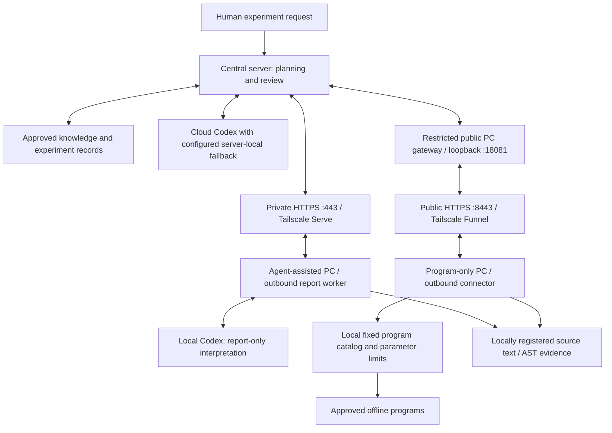

# Two PC deployment profiles

LabOS separates local intelligence from network transport. Both profiles make
outbound authenticated HTTPS requests. Neither requires SSH or an inbound PC
port. Each physical PC receives its own identity and credential.

| | Agent-assisted PC | Program-only PC |
| --- | --- | --- |
| Intended PC | Has Codex and can join the private tailnet | No Codex or local LLM; cannot join the tailnet |
| Local component | Report cooperation worker | Deterministic program connector |
| Network | Private HTTPS through Tailscale, port 443 | Public HTTPS through the restricted gateway, port 8443 |
| Required installation | LabOS portable Python, Tailscale, authenticated Codex CLI | LabOS portable Python only |
| Local interpretation | Report-only Codex runs on explicit tasks | None; central server interprets returned results |
| Task document | `labos_auto_task` | `labos_program_task` with a local `program_id` |
| Local configuration | `config.yaml` + `cooperation.yaml` | `config.yaml` + `program-connector.yaml` |
| Startup | `Install-Cooperation.ps1` | `Install-Program-Connector.cmd` |
| Current shipped operations | Report analysis and registered source excerpts | Runtime check, registered source excerpts, locally approved offline programs |

An agent-assisted PC could also use the public gateway, and a program-only PC
could use a private network if available. The profiles above match this lab's
present deployment needs. Internet HTTPS access must allow the selected port;
some institutional networks permit only outbound 443. If 8443 is blocked, use
an institution-approved domain/reverse proxy on public 443 pointing to the same
restricted gateway, then update only that PC's `server_url`.

## Current server addresses

- Private: `https://aalto-trx50-ai-top.tailaec1b5.ts.net`
- Public PC API: `https://aalto-trx50-ai-top.tailaec1b5.ts.net:8443`
- Central API: loopback `127.0.0.1:18080`; public gateway: loopback `127.0.0.1:18081`.
- Server-local model remains on port 8000 and is not exposed by the PC gateway.

The public gateway permits only health and scoped PC endpoints. The central
operator uses the private endpoint or loopback. A PC credential cannot read
another PC's conversation; the operator credential is rejected at the public
gateway. See [gateway operation](PUBLIC_HTTPS_GATEWAY_EN.md).

## First deployment

For the already commissioned cryostat PC, keep its existing identity, token,
native Codex path and journals. Use the 0.2.4 source-context overlay instructions
to add the two production source roots. Do not replace its working package with
the generic program-only PC configuration.

For the first program-only PC, the private delivery bundle is
`deployments/lab-01/LabOS-Program-PC-01-Windows-x64-0.2.4.zip`. Extract the whole
ZIP to a permanent directory. Double-click `Install-Program-Connector.cmd`.
It validates the bundled runtime, checks authenticated HTTPS, installs a
current-user sign-in shortcut and launches the connector. No model login or
Tailscale client is needed. Do not start `Start-Agent.cmd` for this profile.

The bundle's identity is `program-pc-01`. Deploy it to one physical PC only;
provision a fresh identity and credential before installing a second PC. Treat
this personalized ZIP as a credential-bearing private file. The generic release
ZIPs contain no live credentials and need separate provisioning.

The central queue already contains a deterministic runtime-check task. Once the
PC connector starts, it returns its Python runtime result and the central
background worker reviews the result automatically. Inspect
`data/program-connector/status.json` and `program-connector.log`. A server-only
smoke check does not establish that the new Windows PC has connected.

## Normal cooperation

1. Central sends an immutable task ID/message ID to the relevant PC inbox.
2. The PC polls HTTPS and validates the request against its profile. Agent tasks
   invoke report-only Codex; program tasks select a locally registered program.
3. The PC saves a bounded result locally, then uploads it with the same reply ID
   until acknowledged. Temporary disconnection does not discard the result.
4. Central matches the result with its original task and produces one automatic
   review. Further work requires an explicit new task, preventing reply loops.

The program connector never accepts a peer-selected executable, shell command,
working directory or arbitrary Python code. Local fixed argv and bounded JSON
stdin parameters determine approved programs. Execution intent is durably
recorded before launch; a crash with an uncertain outcome requires local
reconciliation before a new execution request. Keep its execution ledger and
transport journal intact. See [program connector](../src/labos/assets/PROGRAM_CONNECTOR_EN.md).

## Reusing measurement code

Existing production environments and drivers stay on the PC. Registered source
roots let either profile return bounded `.py`/`.md` excerpts and AST outlines
without importing production modules. Central can then propose a small adapter
around an existing stable entry point instead of rewriting the instrument stack.

The initial program catalog contains no measurement entry. Hardware programs
are not enabled by this release's program-only profile (`hardware:true` is
rejected). Before a real acquisition, commission the model-specific wrapper,
device ownership, physical limits, abort/cleanup and result schema. Keep the
working instrument environment separate from the portable network runtime.
Do not label a hardware program as an offline check to bypass commissioning.

The current cryostat acceptance target is a LabOS-orchestrated 730 nm
photoresponse followed by dark second-harmonic transport, with prompt verified
laser/excitation shutdown after each segment. Existing code provides driver and
historical-parameter evidence; the old complete procedure must not be launched
as the run. See the [physical pilot requirements](../subComputer/cryostat/LABOS_BVPE_NLH_PILOT_EN.md).
Source review and local commissioning come first; no physical acquisition has
been performed by this deployment work.

## Verification scope

Public-route acceptance is stored privately in
`deployments/lab-01/PUBLIC_HTTPS_ACCEPTANCE_EN.json`. It records HTTPS certificate
verification against a public DNS relay, authenticated PC reads, rejected
cross-PC/operator credentials and denied operator/model routes. This is a
server-initiated public-route test. A real non-Tailscale Windows installation
must still be observed separately.
