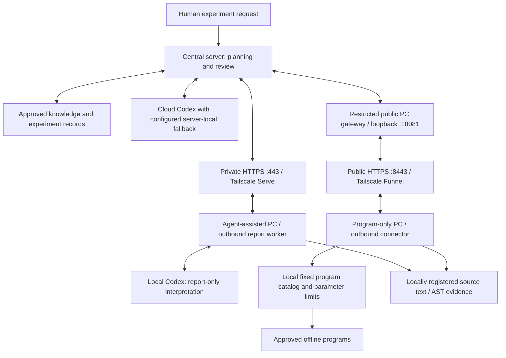

# Two PC deployment profiles

LabOS separates local intelligence from network transport. Both profiles make
outbound authenticated HTTPS requests. Neither requires SSH or an inbound PC
port. Each physical PC receives its own identity and credential.

| | Agent-assisted PC | Program-only PC |
| --- | --- | --- |
| Intended PC | Has authenticated Codex and an approved central route | Requires no local model; uses an approved central route |
| Local component | Report cooperation worker | Deterministic program connector |
| Network | Private HTTPS through Tailscale, port 443 | Public HTTPS through the restricted gateway, port 8443 |
| Required installation | LabOS portable Python, authenticated Codex CLI; VPN if required | LabOS portable Python only |
| Local interpretation | Report-only Codex runs on explicit tasks | None; central server interprets returned results |
| Task document | `labos_auto_task` | `labos_program_task` with a local `program_id` |
| Local configuration | `config.yaml` + `cooperation.yaml` | `config.yaml` + `program-connector.yaml` |
| Startup | `Install-Cooperation.ps1` | `Install-Program-Connector.cmd` |
| Current shipped operations | Report analysis and registered source excerpts | Runtime check, registered source excerpts, locally approved offline programs |

An agent-assisted PC could also use the public gateway, and a program-only PC
could use a private network if available. These routes are example deployment
choices, not provisioned settings. Internet HTTPS access must allow the selected port;
some institutional networks permit only outbound 443. If 8443 is blocked, use
an institution-approved domain/reverse proxy on public 443 pointing to the same
restricted gateway, then update only that PC's `server_url`.

## Endpoint examples and provisioning

Use the operator-provisioned URL. Reserved examples are
`https://central.example.org` for a private central origin and
`https://pc-api.example.org` for a restricted public PC gateway. They are not
live addresses. Keep model/admin endpoints private. The public gateway permits
only health and scoped PC endpoints; a PC credential cannot read another PC's
conversation and the public gateway rejects the operator credential. See
[gateway operation](PUBLIC_HTTPS_GATEWAY_EN.md) and
[network diagnosis](../src/labos/assets/NETWORK_EN.md).

## First deployment

Extract a verified complete generic ZIP to a permanent directory. Obtain a
unique PC identity/credential, connection configuration and the intended profile
through the operator. Generic releases contain no live credential or queued
demonstration task. No historical private delivery bundle is required. Preserve
existing production environments, working Codex paths, source registration and
journals when maintaining an installation; never transplant another PC's identity.

For report-only work, follow
[automatic cooperation](../src/labos/assets/AUTOMATIC_COOPERATION_EN.md).
For a program-only profile, `Install-Program-Connector.cmd` validates the runtime,
checks authenticated HTTPS and installs current-user startup. It needs no local
model. Do not start the generic `Start-Agent.cmd` for either profile unless that
separate simulated execution component is explicitly intended.

Inspect `data/program-connector/status.json` and `program-connector.log` for the
program profile, or the report profile's own configured state/log paths. A fresh
listening snapshot establishes only its last check. A separately authorized new
offline/report task and matching result can establish the relevant round trip;
a server-only smoke check does not prove that the Windows PC is connected.

## Normal cooperation

1. Central sends an immutable task ID/message ID to the relevant PC inbox.
2. The PC polls HTTPS and validates the request against its profile. Agent tasks
   invoke report-only Codex; program tasks select a locally registered program.
3. The PC saves a bounded result locally, then uploads it with the same reply ID
   until acknowledged. Temporary disconnection does not discard the result.
4. Central matches the result with its original task and produces one automatic
   review. Further work requires an explicit new task, preventing reply loops.

The program connector never accepts a peer-selected executable, shell command,
working directory or arbitrary Python code. Local fixed argv and bounded JSON
stdin parameters determine approved programs. Execution intent is durably
recorded before launch; a crash with an uncertain outcome requires local
reconciliation before a new execution request. Keep its execution ledger and
transport journal intact. See [program connector](../src/labos/assets/PROGRAM_CONNECTOR_EN.md).

## Reusing measurement code

Existing production environments and drivers stay on the PC. Registered source
roots let either profile return bounded `.py`/`.md` excerpts and AST outlines
without importing production modules. Central can then propose a small adapter
around an existing stable entry point instead of rewriting the instrument stack.

The initial program catalog contains no measurement entry. Hardware programs
are not enabled by this release's program-only profile (`hardware:true` is
rejected). Before a real acquisition, commission the model-specific wrapper,
device ownership, physical limits, abort/cleanup and result schema. Keep the
working instrument environment separate from the portable network runtime.
Do not label a hardware program as an offline check to bypass commissioning.

The separate finite physical pilot supports only fixed commissioned scopes.
Read the [physical pilot guide](PHYSICAL_PILOT_EN.md),
[onsite checklist](ONSITE_COMMISSIONING_EN.md),
[authority guide](PHYSICAL_AUTHORITY_EN.md),
[update recovery](PORTABLE_UPDATE_RECOVERY_EN.md) and
[reliability limits](RELIABILITY_IMPROVEMENTS_EN.md). These guides ship at the
physical overlay root; generic source releases include them under `docs/`.
Report-only Codex cannot install code, change approval or operate instruments.
Onsite wiring inspection, legacy-worker retirement, physical reconciliation and
commissioning of the same frozen enabled profile remain mandatory before a
separately authorized new finite task. All historical pilot IDs retire at the
new cutoff; neither old tasks nor unknown operations may replay.

## Verification scope

Record the actual package/source version, component configuration identity,
route/authentication result and remaining gaps in a sanitized local handoff.
A report connection pass, synthetic rehearsal or historical version capability
is not proof of physical commissioning. Local stage/status events are not a
continuous central telemetry stream. Broad memory/RAG, arbitrary MCP/skills,
theory-guided adaptation, autonomous calibration and coordinated cross-PC
physical barriers remain planned.
