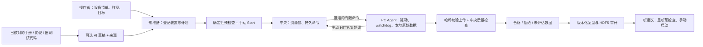

# LabOS v0.2：数据资格检查与实验复盘

参考：[Autonomous Quantum Measurement with Agentic AI（QUANTA）](https://arxiv.org/abs/2610.38850)，尤其补充材料关于测量资格检查、保护边界、资料检索和证据归档的部分。本次是现有光学模拟系统上的工程改进，没有复现论文的输运装置和科学结论。

## 架构变化



保留“中央规划、本地执行”。各实验室 Windows PC 仍主动连接中央，不需要开 SSH 或入站端口。设备独占、断网故障锁和 UNKNOWN 不自动重放继续生效。

## 运行和升级

在项目目录执行：

```bash
# 本机三个独立进程，验证通信与模拟采集；每次换新目录
.venv/bin/python -m labos demo --directory runtime/my-v02-demo
# 启动已生成配置的中央服务
.venv/bin/python -m labos central --config deployments/lab-01/central/config.yaml
```

多 PC 配置、分发与网络部署见 [部署指南](DEPLOYMENT_ZH.md) 和 [网络方案](NETWORK_ZH.md)。Windows PC 使用其专属 ZIP，先运行 `Doctor.ps1`，再运行 `Start-Agent.cmd`。不要把中央配置或操作凭证复制到 PC。中央和 PC 应一起升级到 0.2；旧数据、日志和配置应保留，旧实验先核对收尾，不能直接续跑。

本次通用包在 `dist/v0.2.0/`：`LabOS-Central-0.2.0.zip`、`LabOS-Agent-0.2.0.zip`、`LabOS-Agent-Windows-x64-0.2.0.zip`。通用包没有部署凭证；Windows 包包含现有便携 Python。个性化 PC 包仍通过 `labos bundle` 生成。

## 实验前与实验后的流程

1. 中央登记 PC 设备归属、驱动版本、物理连接、光路/接线、校准说明和样品限制；操作者确认真实装置。目前仅模拟驱动可用，不能靠修改 `mode` 启用硬件。
2. 在“实验资料与已有测试代码”导入 UTF-8 文本，填写标题、来源路径/链接、类型，核对后勾选确认。保存形成不可变版本，不执行代码，也不自动抓取链接。PDF 请先提取需要的文字。
3. 检索已核对的最新版，点击“引用到本次计划”；或生成带检索来源的自然语言草稿。每个计划最多五份资料；被替代的旧版资料不能继续用于尚未开始的新计划。
4. 填写扫描参数和样品限制，设置可选 counts 拒绝阈值。留空仍检查仪器过载标志与登记的探测器上限。阈值属于本次采集有效性标准，不是普适 SNR、精度或损伤阈值。
5. 点击“检查实验准备”，核对后手动 Start。启动会重新检查登记限制与资料状态。
6. 查看合格／拒绝／未评估计数。过载或触及阈值会停止当前扫描，保留原始数据，执行停光并核对软件读回。离线遥测明确标为历史缓存。
7. 查看／刷新复盘，检查测量 ID、来源、计划/配置哈希、拒绝原因、收尾读回、解释限制。建议可以载入预准备，但不会自动启动。

资料检索、确定性复盘、质量检查和模拟采集不需要模型/API key。自然语言草稿需要中央配置 `openai_model` 与 `OPENAI_API_KEY`；点击生成草稿时，会把匹配到的已核对摘录发给模型，导入前请移除密钥等内容。本次没有调用收费模型 API。

## 已有硬件测试代码怎么用

可以先作为资料导入。建议提供设备型号/地址、SDK 与 Python 版本、初始化和连接代码、只读查询、单次采集、单位换算、原始返回格式、异常处理、停机步骤，以及已知可用的测试记录。保留 PC 的现有控制环境，复制脱敏后的相关文件或摘录即可。

被引用的代码尚未成为驱动。真实接入需要把已验证调用封装为 `InstrumentDriver` 的有限操作，在目标 PC 验证设备身份、实际读回、超时、取消、互斥、停机和本地保存。USB/串口/VISA/厂商 SDK 按现用测试环境保留，具体见 [硬件接入指南](HARDWARE_ZH.md)。

## 数据和接口

- 原始 JSON 在采集 PC `data/cache/` 与中央 `data/raw/`。资格结果单独保存，不覆写原始上传文件。
- 新采集绑定 `plan_sha256`、`configuration_sha256`；配置指纹包括装置、设备归属和登记参数，不含凭证，也不证明物理接线或校准真实性。
- HDF5 `raw/`、`metadata/measurements_json` 仅含合格数据；`audit/measurements_json`、`audit/qualifications_json`、`audit/artifact_sha256` 保留全部同步记录及摘要。全被拒绝也可导出，`raw/counts` 为零行。JSON 为规范化结构，摘要对应保留的原始上传字节。
- 历史数据库中缺少资格记录的数据标为 `unassessed`。旧 `runs.points` 可能保留历史计数，界面和复盘使用显式资格统计，不追溯伪造质量结论。
- `POST /api/evidence` 导入；`GET /api/evidence?q=...` 默认检索已核对的当前版。
- `GET /api/runs/{id}/measurements?qualified_only=true` 只返回合格记录；不加参数返回全部记录。
- `POST /api/runs/{id}/review` 保存当前复盘，相同证据去重；`GET .../review` 读最近快照，`GET .../reviews` 读历史。晚到数据不会覆盖旧快照，需要刷新生成新版。
- 上述接口均需中央操作凭证，PC Agent 凭证不能导入资料、查看复盘或启动实验。

质量检查目前涵盖探测器过载和 counts 上限；结构、有限数值检查仍由数据模型执行。坏格式/非有限数据不能进入正常测量表，应结合 PC 日志诊断。重复测量的相关性分析、漂移/稳态检验、可检出性、机理推断、自动接线和无人值守实验系列尚未实现，需要具体仪器与实验设计。

## 构建与验收

```bash
.venv/bin/python -m pytest -q
.venv/bin/ruff check src tests scripts
.venv/bin/python scripts/quality_acceptance.py
.venv/bin/python scripts/network_fault_acceptance.py
.venv/bin/python scripts/browser_acceptance.py  # 开发环境需 playwright + Chromium
.venv/bin/python scripts/build_delivery.py --output dist/v0.2.0 \
  --windows-runtime dist/delivery/windows-x64-runtime.zip
```

结果见 [v0.2 验收记录](QUANTA_ACCEPTANCE_ZH.md)。Windows 实机、真实 LAN/VPN/TLS 和物理仪器尚未验收，Linux 模拟测试不能替代这些步骤。
