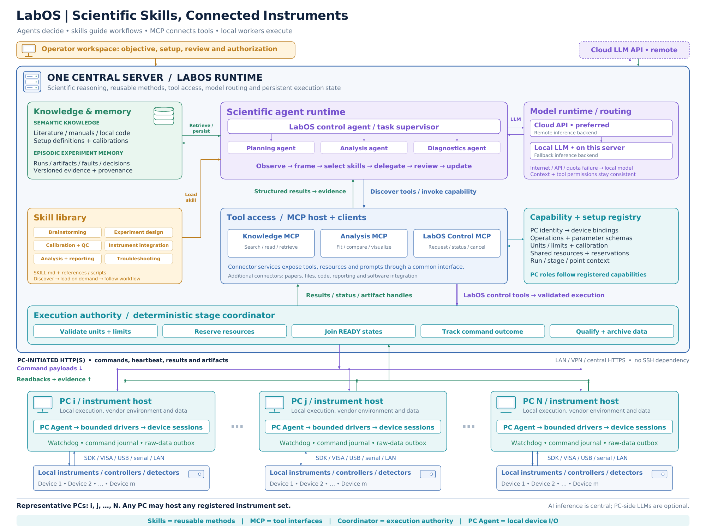

# LabOS 系统架构汇报讲稿 / LabOS Architecture Presentation Script

适用于组会、项目介绍和跨实验室交流。中文与英文讲稿相互对应，可选择其中一种语言直接使用；完整讲解约 8–12 分钟，另附一分钟介绍和常见问答。

For group meetings, project presentations and discussions across laboratories. The Chinese and English scripts cover the same material. Use either language for an approximately 8–12 minute presentation, or use the one-minute introduction for a shorter overview.

配套材料 / Accompanying materials: [Architecture PDF](LabOS_System_Architecture_EN.pdf) · [Editable PowerPoint](LabOS_System_Architecture_EN.pptx) · [SVG](LabOS_System_Architecture_EN.svg)

## 1. 怎么讲这张图 / How to present the figure

建议先介绍系统解决的问题，再从中央 Agent 展开到知识、方法和工具，最后沿执行路径讲到 PC 与仪器。不要逐个朗读框中的文字；用一次实验把模块联系起来。

Start with the problem the system addresses. Then explain the central agent and its knowledge, methods and tools. Follow the execution path down to PCs and instruments, and use one experiment to connect the components. Point to the figure as you speak rather than reading every label.

| 顺序 / Order | 指向图中 / Point to | 听众应理解的内容 / Main message |
| --- | --- | --- |
| 1 | Operator workspace + overall server/PC layout | 一个实验可以跨电脑组织 / One experiment can span multiple computers |
| 2 | Scientific agent runtime | 主 Agent 统筹，子 Agent 分工 / The supervisor coordinates specialist work |
| 3 | Knowledge & memory + Skill library | 知识和历史提供依据，Skill 提供方法 / Knowledge and history provide evidence; skills provide methods |
| 4 | MCP tool access + capability registry | 工具接口与实际资源相连接 / Tool interfaces are bound to available resources |
| 5 | Execution coordinator → PC Agent → devices | 科学计划经过校验后才成为设备动作 / A scientific plan becomes device actions through validated execution |
| 6 | Model runtime + return arrows | 模型可切换，测量证据形成反馈 / Inference can change backend, while measurement evidence closes the loop |

## 2. 一分钟介绍 / One-minute introduction

### 中文

LabOS 的目标，是把分散在多台实验室电脑上的设备组织成一个可协调、可追溯的实验系统。研究者提出目标，中央服务器上的 Agent 结合文献、仪器资料和历史实验，选择合适的 Skill，并调用工具制定实验阶段。设备操作经过统一协调器校验，再由各电脑上的本地执行程序完成。原始数据、设备读回和质量结果返回中央，作为分析和下一步决策的依据。

图里的 PC i、PC j 到 PC N 代表整个子电脑群，具体设备归属由登记配置决定。Skills 提供可复用的实验方法，MCP 提供工具接口。模型计算集中在中央侧：云端模型不可用或额度耗尽时，可以切换到服务器本地模型。我们希望复用设备、实验方法和数据证据，让跨电脑协同成为实验设计的一部分。

### English

LabOS organizes instruments distributed across laboratory computers into a coordinated experiment system with traceable evidence. A researcher defines the objective. Agents on the central server use literature, instrument documentation and experiment history to select relevant skills and request tools. A deterministic coordinator validates device actions, and local workers execute them on the computers that own the instruments. Raw data, readbacks and quality results return to the server for analysis and the next decision.

PC i, PC j and PC N represent an arbitrary fleet; device ownership is configured rather than fixed by the diagram. Skills provide reusable experimental methods, while MCP provides tool interfaces. Inference uses cloud models with a server-local fallback. The aim is to make instruments, scientific procedures and experimental evidence reusable across connected computers.

## 3. 中文完整讲稿

### 3.1 从实验室的实际问题开始

【指向整张图】

今天介绍的是 LabOS 的系统架构，以及它怎样组织一个跨电脑的实验。

实验室里的设备通常已经连接在不同电脑上。有些电脑保留了特定的厂商软件、驱动和经过验证的测试代码。当一个实验需要同时使用光源、低温磁场环境、输运读出和光电测量时，我们需要把这些已有资源按照统一的实验目标协调起来。

LabOS 采用一台中央服务器加一组设备电脑的结构。中央负责实验上下文、任务组织和记录；设备电脑保留本地连接与控制环境。图中的 PC i、PC j、PC N 只是示意，既不限定电脑数量，也不规定哪台电脑必须负责某一类实验。设备可以按照实验室实际接线登记，再组合到同一个实验中。

### 3.2 中央 Agent 怎样组织工作

【指向 Scientific agent runtime】

中央的主 Agent 可以理解为实验任务的统筹者。它接收科研目标，检查已有信息，组织测量阶段，并根据返回的证据提出下一步建议。

规划、分析和诊断等工作可以交给专业子 Agent。例如，规划子 Agent 整理扫描变量与对照测量；分析子 Agent 比较重复点、拟合结果和参考数据；诊断子 Agent 根据状态、日志和异常寻找原因。主 Agent 汇总这些结果，保持同一个样品、任务目标和资源上下文。

这里的子 Agent 表示职责分工，不意味着每个子 Agent 都要拥有一台独立电脑或一套独立模型。它们可以共享中央的模型入口和知识服务，并由统一策略分配各自的工具权限。

### 3.3 知识、记忆和 Skill 各自提供什么

【先指向 Knowledge & memory，再指向 Skill library】

知识包括文献、仪器手册、已有控制代码、装置定义和校准资料。实验记忆则保存这套装置实际做过什么：使用了哪份配置、获得了哪些原始数据、发生过什么异常，以及当时作出了怎样的判断。这些内容需要保留来源和版本，方便后续核对。

Skill 提供的是可复用的方法。比如，Brainstorming Skill 帮助梳理研究问题和可区分的假设；实验设计 Skill 组织变量、参考点和对照实验；校准与质量检查 Skill 规定需要保存的校准关系和检查步骤；仪器集成 Skill 指导怎样复用已有接口与测试代码。

因此，知识和记忆回答“有哪些依据、以前发生过什么”，Skill 回答“这类任务应该按什么方法完成”。Agent 根据当前任务加载相关 Skill，并结合实际资源使用它，而不必每次从零组织整个流程。

*方法定义参考，无需朗读：[Agent Skills 概述](https://agentskills.io/home)与[格式规范](https://agentskills.io/specification)。*

### 3.4 MCP 怎样连接工具和实际能力

【指向 Tool access / MCP host + clients】

Agent 需要通过工具完成检索、计算和操作。MCP 在这套设计中提供统一的工具访问接口。图中把连接器分为知识、分析和 LabOS 控制几类：知识工具负责搜索和读取资料，分析工具负责拟合、比较与绘图，控制工具负责请求阶段、查询状态和取消任务。

可以把一次调用理解为：Agent 根据 Skill 选择合适的操作，通过工具接口提出结构化请求，再接收带状态和来源的结果。MCP server 在这里指提供接口的软件服务，不等于要为每个连接器增加一台物理服务器，也不要求每台设备电脑都安装 MCP 服务。

*接口角色参考，无需朗读：[MCP 官方架构](https://modelcontextprotocol.io/docs/learn/architecture)与[服务端能力](https://modelcontextprotocol.io/docs/learn/server-concepts)。*

设备操作仍然进入 LabOS 的统一执行协调器。加入新的 Skill 或工具连接器时，也沿用这条执行路径。

### 3.5 资源登记与实验准备

【指向 Capability + setup registry】

中央需要知道当前有哪些可调用的资源。登记内容包括 PC 与设备身份、设备连接和驱动、支持的操作、参数单位、允许范围、校准关系，以及哪些资源不能同时被占用。

实验准备还需要补上样品信息，例如电极接线、Vxx 与 Vxy 的空间对应、光路、栅压设置和本次实验的操作边界。可复用的设备配置与每次变化的样品配置可以分别保存。

有了这层登记，中央就能够把“在某个温度和磁场下，改变激励并采集信号”的科学描述，映射到具体设备及其所属电脑。任务根据资源能力进行组合，电脑本身不需要被永久定义为“光学电脑”或“输运电脑”。

### 3.6 从科学计划到设备动作

【沿 Execution coordinator → PC Agent → instruments 向下讲】

实验计划进入协调器以后，需要检查参数和单位、占用所需设备，并确认相关设备达到本阶段的就绪条件。执行过程中，协调器记录命令身份、执行结果和采集数据，使“提出了一个请求”“设备完成了动作”“测量数据可以用于分析”成为可区分的状态。

设备电脑上的 PC Agent 是一个持续运行的执行程序。它负责本地驱动、设备会话、状态回报、命令日志和原始数据保存。一台 PC Agent 可以管理多台仪器，不要求每台电脑安装大模型。已有测试代码可以经过整理与验证，封装成连接、设置、读回、采集和停止等有限操作。

网络连接由设备 PC 主动发起。中央在请求响应中返回任务，PC 回传心跳、结果和数据文件，所以实验运行不依赖 SSH。数据先在本地保存，再进行同步；如果某条物理命令的结果不明确，需要核对设备状态，不能因为网络重连就直接重复执行。

### 3.7 云端模型与服务器本地模型

【指向 Model runtime / routing】

中央模型入口可以使用云端模型，也可以使用服务器上的本地大模型。按照这套部署设计，云端访问失败、API 不可用或调用额度耗尽时，模型路由切换到本地模型，继续使用同一套实验上下文、工具定义和权限。

这里保留的是任务、数据和操作约束；不同模型的回答质量仍需要通过结构化输出和执行校验来约束。如果模型无法提出有效请求，流程应该保留状态，等待修正。

云端连接中断与设备 PC 失联是两种情况。前者可以通过切换模型处理；后者仍需要本地执行程序和恢复流程处理。模型切换本身不改变仪器归属、实验边界或已派发命令的记录。

### 3.8 用 Hall 与 BVPE 联合实验串起整个系统

【指向中央 Agent，随后沿工具、协调器、PC 和返回箭头走一遍】

例如，研究者希望在一组温度、磁场和栅压条件下，先测非线性 Hall，再比较同一样品的光电响应。

首先，系统整理样品接线、校准与已有记录，加载实验设计、校准和分析等相关 Skill。规划阶段把任务拆成环境准备、暗态输运、光功率与偏振配置、光电采集以及返回参考点等阶段。

在 Hall 阶段，一台输运锁相提供正弦激励并配合串联电阻建立电流，同时读取纵向 Vxx；另一台锁相读取选定谐波的横向 Vxy。一个典型阶段是 Vxx 的基频与 Vxy 的二次谐波，其他通道配置作为后续测量阶段。记录中需要保留实际电流标定、谐波、相位和量程。Vxx/Vxy 表示空间通道，各锁相返回的 X/Y 表示相位分量。

在光电阶段，可以选择 730 nm 或配置后的 SuperK 激发，结合 chopper、偏振元件、PD 功率监测和 BVPE 锁相读出。CLD1000 设置激光驱动电流，PD 与光路校准提供样品处光功率的依据；光电锁相使用 chopper 的物理参考。

这些资源可以分布在不同电脑上。协调器把达到条件的测量阶段关联到共同的样品和实验坐标，并记录各次采集的时间窗口。相位参考和严格同步仍由适当的物理参考线或硬件触发实现。

最后，原始数据、实际环境、校准信息和质量结果返回中央。分析工作比较参考点、重复性和不同条件下的响应，再形成下一轮测量建议。这里展示的是系统组织实验的方式；具体信号机制还需要相应的对照实验和证据支持。

### 3.9 收尾时强调什么

【回到整张图】

这张图把科研目标、可复用方法、工具接口、可靠执行和数据证据连接在一起。增加设备时，主要工作是登记资源并验证本地驱动；复用实验方法时，可以复用 Skill 和阶段定义；更换模型时，执行记录和工具权限仍保留在系统中。

LabOS 的价值，是让分散的设备围绕同一个科研问题协同工作，并让每个结论能够回到相应的测量、校准和操作记录。

## 4. Full English presentation script

### 4.1 Start with the laboratory problem

[Point to the whole figure.]

Today I will explain the LabOS architecture and how it organizes an experiment across laboratory computers.

Instruments are often attached to different PCs. Each computer may already contain vendor software, drivers and tested acquisition scripts. An experiment combining optical excitation, a cryogenic environment, transport and photoresponse needs these existing resources to work toward a common objective.

LabOS uses one central server and a fleet of instrument-host computers. The server maintains experiment context and coordinates work, while each instrument host retains its local connections and software environment. PC i, PC j and PC N are representative symbols. They specify neither a fixed number of computers nor permanent scientific roles. Resources are registered according to the actual laboratory configuration and composed into experiments.

### 4.2 Explain the central agents

[Point to Scientific agent runtime.]

The main control agent supervises the scientific task. It receives the objective, checks available information, organizes measurement stages and reviews the evidence returned from execution.

Specialist agents can handle planning, analysis and diagnostics. A planning agent organizes variables and controls. An analysis agent compares reference measurements and fitted results. A diagnostics agent examines status and logs when a problem occurs. The supervisor brings their results together within the same sample, objective and resource context.

These are divisions of responsibility. They do not require separate physical computers or separate model installations for every agent. The agents can share central model access and knowledge services, with role-appropriate tool permissions.

### 4.3 Distinguish knowledge, memory and skills

[Point first to Knowledge & memory, then to Skill library.]

Knowledge includes literature, instrument manuals, existing code, setup definitions and calibration information. Experiment memory records what this setup actually did: which configuration was used, what raw data were produced, which faults occurred and which decisions followed. Sources and versions make these records inspectable.

Skills provide reusable methods. A brainstorming skill helps frame questions and distinguish hypotheses. An experiment-design skill organizes variables, reference points and controls. Calibration and quality skills specify procedures and required records. An instrument-integration skill guides reuse of existing interfaces and tested code.

Knowledge and memory provide evidence and history; skills provide procedures. The agent loads relevant skills for the current task and applies them to the resources available, rather than rebuilding the entire workflow each time.

*Definition references, not spoken narration: [Agent Skills overview](https://agentskills.io/home) and [format specification](https://agentskills.io/specification).*

### 4.4 Explain the MCP tool layer

[Point to Tool access / MCP host + clients.]

Agents need tools for retrieval, computation and operations. MCP provides a common interface to those capabilities. In this design, knowledge connectors search and read information, analysis connectors fit and compare data, and LabOS control connectors request stages, inspect status and cancel tasks.

A typical interaction is to select an operation according to a skill, submit a structured request and receive a result with status and provenance. An MCP server is a software service exposing an interface. It does not imply another physical server for every connector, or an MCP installation on every instrument PC.

*Interface references, not spoken narration: [official MCP architecture](https://modelcontextprotocol.io/docs/learn/architecture) and [server capabilities](https://modelcontextprotocol.io/docs/learn/server-concepts).*

Instrument actions still enter the shared execution coordinator. Additional skills and connectors use the same execution path.

### 4.5 Explain resource registration and preparation

[Point to Capability + setup registry.]

The server must know which capabilities are available. Registration describes PC and device identities, connections and drivers, supported operations, parameter units, allowed ranges, calibrations and exclusive resources.

Preparation also records sample-specific information: contact wiring, the spatial Vxx/Vxy mapping, optical paths, gate configuration and the operating envelope for this experiment. Reusable device configurations can be kept separate from settings that change with each sample.

This allows a scientific instruction—prepare a temperature and field, change an excitation and acquire a signal—to be mapped to concrete devices and their host PCs. Tasks follow registered capabilities rather than permanent computer roles.

### 4.6 Follow a plan down to the instruments

[Follow Execution coordinator → PC Agent → instruments.]

The coordinator checks parameters and units, reserves the required devices and joins their readiness conditions before releasing a measurement stage. It records command identity, outcomes and artifacts. A submitted request, a completed device action and a scientifically usable measurement are separate states.

A PC Agent is a persistent execution service. It owns local drivers and device sessions, reports status, maintains a command journal and saves raw data. One worker can manage several instruments without a PC-side LLM. Existing tested code can be reviewed and wrapped into bounded operations such as connect, set, read back, acquire and stop.

Instrument PCs initiate network requests. The central server returns command payloads in responses, and workers send heartbeats, results and artifacts. SSH is therefore not required for experiment operation. Data are saved locally before synchronization. When a physical command has an uncertain outcome, the system reconciles device state instead of replaying it merely because the network reconnects.

### 4.7 Explain cloud and local inference

[Point to Model runtime / routing.]

The central model interface can use a cloud model or the server's local LLM. In the deployment design, cloud connectivity failure, API unavailability or exhausted invocation quota triggers a switch to the local backend, with the same experiment context, tool definitions and permissions.

The system preserves the task and its constraints. Different models may still produce different answers, so structured outputs and execution checks remain necessary. If a model cannot produce a valid request, the workflow should retain its state and wait for correction.

Cloud disconnection and loss of an instrument PC are different events. Model fallback addresses the first; local execution and recovery procedures address the second. Changing inference providers does not change device ownership, operating limits or the command ledger.

### 4.8 Walk through a Hall and BVPE campaign

[Trace the path from agents through tools and execution, then back through the result arrows.]

Suppose the researcher wants to measure nonlinear Hall response and then compare the sample's photoresponse at a set of temperatures, magnetic fields and gate voltages.

Preparation gathers wiring, calibration and prior records, and selects relevant experiment-design, calibration and analysis skills. Planning divides the campaign into environmental preparation, dark transport, optical power and polarization configuration, photoresponse acquisition and return references.

For Hall transport, one lock-in supplies sine excitation through a series resistor and reads longitudinal Vxx. The other reads transverse Vxy at the selected harmonic. A typical stage combines fundamental Vxx with second-harmonic Vxy; other configurations are acquired in subsequent stages. Records retain current calibration, harmonic, phase and range. Vxx/Vxy identify spatial channels, whereas each lock-in's X/Y identify phase components.

For the optical stage, the setup selects 730 nm or configured SuperK excitation, using the chopper, polarization optics, PD monitoring and the BVPE lock-in. CLD1000 sets laser drive current; the PD and optical-path calibration establish sample-plane power. The optical lock-in uses the physical chopper reference.

Resources may reside on different computers. The coordinator links ready measurement stages to common sample and state identities and records acquisition windows. Physical references or suitable hardware triggers provide phase coherence and strict timing where required.

Raw data, environmental readbacks, calibrations and quality results return to the server. Analysis compares references, repeatability and response under different conditions, then proposes the next measurement. This illustrates experiment organization; assigning a physical mechanism still requires the appropriate controls and evidence.

### 4.9 Close with the system's value

[Return to the whole figure.]

The architecture connects scientific objectives, reusable methods, tool interfaces, dependable execution and experimental evidence. Adding an instrument involves registering its resources and validating its local adapter. Reusing a method can reuse skills and stage definitions. Changing models leaves execution records and tool permissions within the system.

LabOS helps distributed instruments work toward one research question, while keeping conclusions connected to the measurements, calibrations and actions that support them.

## 5. 常见问答 / Questions and answers

### Q1. 每台电脑都要运行大模型吗？ / Does every PC need an LLM?

**中文：** 不需要。设备电脑上的 PC Agent 是本地执行服务，负责驱动、设备会话和数据。模型推理通过中央入口使用云端或服务器本地模型。只查看网页的电脑不需要 PC Agent。

**English:** No. A PC Agent handles drivers, sessions and data. Inference uses the central cloud/local model interface. A browser-only computer does not need an instrument worker.

### Q2. Agent、Skill、MCP 的区别是什么？ / How do agents, skills and MCP differ?

**中文：** Agent 组织任务和作出选择；Skill 提供完成某类任务的方法；MCP 提供工具和资源的接口。一次校准可以由 Agent 选择校准 Skill，再调用计算工具和经过协调器批准的设备操作。

**English:** An agent organizes the task and makes choices. A skill provides a method. MCP provides interfaces to tools and resources. For a calibration, the agent selects the procedure, uses computation tools and requests validated device operations.

### Q3. 图中是不是只有三台子电脑？ / Does the diagram limit the system to three PCs?

**中文：** 图中只是用少量节点表示任意规模的电脑群。实际数量、设备归属和可调用能力由登记配置决定，单台电脑也可以管理多台设备。

**English:** The symbols represent an arbitrary fleet. Configuration determines the actual hosts, device ownership and capabilities. One host can manage several instruments.

### Q4. 断网后切换本地模型，是不是实验就一定能继续？ / Does local-model fallback guarantee continued execution?

**中文：** 需要区分云端模型连接和设备连接。设备仍可达、所需工具仍可用且本地模型能返回有效请求时，模型侧工作可以继续。设备 PC 失联或动作结果不明确时，仍按本地故障与恢复流程处理。

**English:** Cloud access and instrument connectivity are separate. Inference can continue when devices and tools remain available and the local model produces valid requests. A disconnected worker or uncertain device outcome still requires the corresponding recovery procedure.

### Q5. 现有测试代码、厂商程序和 REA 怎么用？ / How can existing code, vendor applications and REA help?

**中文：** 已有源码和可用测试记录可以作为仪器集成的依据，经过验证后封装成有限驱动操作。REA 可以作为分析已有程序包或运行行为的可选工具；它并非实验执行的必需组件，分析结果也不自动成为经过验证的驱动。

**English:** Existing source and test records can support integration and be wrapped into validated driver operations. REA is an optional tool for investigating packaged applications or runtime behavior. It is not required for experiment execution, and its findings do not automatically constitute a validated driver.

*项目资料 / Project reference: [REA](https://github.com/morluto/rea).*

### Q6. 跨 PC 协调是否意味着同时采样、自动锁相？ / Does coordination imply simultaneous sampling or phase locking?

**中文：** HTTP(S) 负责状态、任务与数据组织。阶段屏障表示所需设备达到就绪条件，各次采集仍要记录时间窗口。锁相参考和严格同步需要相应的物理参考线或硬件触发。

**English:** HTTP(S) coordinates state, tasks and data. A readiness barrier joins required conditions; acquisition windows are still recorded separately. Phase references and strict synchronization require appropriate physical reference or trigger connections.

### Q7. 如何避免把异常数据当成科学结论？ / How are anomalous data separated from conclusions?

**中文：** 保存原始数据，把资格判断与分析结果分开记录，并保留实际读回、校准版本和拒绝原因。分析还要结合参考点与对照实验。软件资格检查不能单独证明某个物理机制。

**English:** Retain raw data and record qualification separately from interpretation, together with readbacks, calibration versions and rejection reasons. Analysis uses references and controls; software qualification alone does not establish a physical mechanism.

## 6. 中英术语对照 / Bilingual terminology

| 中文 | English | 报告中的含义 / Meaning in this presentation |
| --- | --- | --- |
| 中央服务器 | Central server | 承载科学运行时与协调状态 / Hosts the scientific runtime and coordination state |
| 控制 Agent / 任务统筹者 | Control agent / task supervisor | 保持目标、组织任务并审阅证据 / Maintains objectives, organizes work and reviews evidence |
| 专业子 Agent | Specialist sub-agent | 承担规划、分析或诊断职责 / Handles planning, analysis or diagnostics |
| 技能 / 方法包 | Skill | 可复用的任务方法及相关资料、脚本 / Reusable procedures with references and supporting scripts |
| 模型上下文协议 | Model Context Protocol, MCP | 工具、资源和提示模板的访问协议 / Protocol for tools, resources and prompts |
| 知识与实验记忆 | Knowledge and experiment memory | 文献与装置资料，以及可追溯的实验历史 / Documentation and attributable experiment history |
| 能力与装置登记 | Capability and setup registry | 设备归属、操作接口、单位与限制 / Device bindings, operations, units and limits |
| 确定性执行协调器 | Deterministic execution coordinator | 按明确规则校验和调度操作 / Validates and schedules actions using explicit rules |
| 本地 PC 执行程序 | PC Agent / local execution worker | 维护设备会话并执行有限操作 / Owns sessions and executes bounded operations |
| 就绪屏障 | Readiness barrier | 所需参与者达到条件后释放阶段 / Releases a stage after required participants are ready |
| 数据资格判断 | Data qualification | 按明确标准判断采集是否可用 / Assesses acquisition usability against stated criteria |
| 来源与追溯信息 | Provenance | 连接数据、配置、校准和操作记录 / Links data to configurations, calibrations and actions |
| 模型故障切换 | Model failover | 云端不可用时改用本地推理后端 / Switches to local inference when cloud access is unavailable |

## 7. 报告者备查：架构与原型的口径 / Presenter reference: architecture and prototype scope

本稿主要解释系统设计。对外报告可以用“系统设计为……”和“在该实验场景中……”描述架构能力；讲到已验证成果时，应以实际验收记录为依据。下面内容供回答进展问题使用，无需逐项朗读。

This script primarily explains the architecture. Use “the system is designed to…” or “in this experimental scenario…” for architectural capabilities. Describe validated results using the actual acceptance records. The table below is for progress questions rather than the main narration.

| 范围 / Scope | 准确的介绍方式 / Accurate wording |
| --- | --- |
| 中央协调、本地执行、资料与数据追溯 / Coordination, workers and provenance | 仓库已有原型与模拟验收记录；可引用对应流程的记录 / The repository contains a prototype and recorded simulated acceptance runs |
| Skills、MCP 和专业子 Agent / Skills, MCP and specialist agents | 这张图定义其职责及扩展接口；架构图本身不代表这些连接器已全部实装 / The figure defines roles and extension points; it does not establish that all connectors are deployed |
| 服务器本地大模型 / Server-local LLM | 服务器具备本地模型是用户提供的部署条件；应用层切换效果应结合实际路由与工具调用记录说明 / Local model availability is a user-supplied deployment condition; routing behavior should be described from actual runtime records |
| Hall / BVPE 联合实验 / Hall/BVPE campaign | 用于解释系统组织方式的应用场景；本稿不提供材料实测曲线或机制结论 / An application scenario explaining orchestration, without sample measurements or mechanism claims |

当前仓库的可选 AI 入口生成计划草稿，经过预检查后由操作者启动。图中的完整科学 Agent、Skill/MCP 组合与模型路由描述系统设计；不要把草稿生成和模拟验收表述成已完成真实装置的全自主实验。

The repository's optional AI entry point produces a plan draft, followed by preflight and operator start. The complete scientific-agent, Skill/MCP and model-routing composition describes the system design. Draft generation and simulated acceptance runs should not be presented as a fully autonomous experiment on the physical apparatus.

## 8. 资料与来源 / References and supporting material

- [LabOS architecture description](README.md)：本图各组件、调用关系与复现方法 / Components, relationships and figure reproduction.
- [Prototype improvements](../../../../docs/QUANTA_IMPROVEMENTS_ZH.md) · [Recorded v0.2 acceptance](../../../../docs/QUANTA_ACCEPTANCE_ZH.md)：原型功能与验收范围 / Prototype behavior and recorded validation scope.
- [Network design](../../../../docs/NETWORK_ZH.md) · [Instrument integration](../../../../docs/HARDWARE_ZH.md)：PC 通信与现有代码接入 / PC communication and reuse of existing instrument code.
- [Agent Skills overview](https://agentskills.io/home)：Skill 的结构与按需加载 / Skill structure and on-demand loading.
- [Official MCP architecture](https://modelcontextprotocol.io/docs/learn/architecture)：MCP host、client、server 与接口 / MCP participants and interfaces.
- [REA — morluto/rea](https://github.com/morluto/rea)：可选的软件分析工具参考 / Optional software-inspection tooling reference.
- [Sodemann & Fu, PRL 115, 216806](https://doi.org/10.1103/PhysRevLett.115.216806)：非线性 Hall 理论背景 / Nonlinear Hall theoretical context.
- [Ma et al., Nature 565, 337–342](https://doi.org/10.1038/s41586-018-0807-6)：非线性 Hall 实验背景 / Nonlinear Hall experimental context.
- [Osterhoudt et al., Nature Materials 18, 471–475](https://doi.org/10.1038/s41563-019-0297-4)：体光伏响应背景 / Bulk photovoltaic-response context.

## 9. 进一步讲解运行闭环 / Explaining the execution loop in more depth

关于设备怎样通信、自主校准怎样完成、中央如何根据实时数据调整实验，以及计划中的服务器本地理论计算，请继续使用 [输运闭环流程图与中英文讲稿](../Transport_Closed_Loop/LabOS_Transport_Workflow_ZH_EN.md)。该材料用非线性 Hall 的电流、频率、幅相与环境对照，把总体架构展开为具体运行步骤。

For instrument communication, autonomous calibration, live experimental revisions and planned server-local physics calculations, continue with the [transport workflow and bilingual guide](../Transport_Closed_Loop/LabOS_Transport_Workflow_ZH_EN.md). It turns this architecture into operational steps using nonlinear Hall current, frequency, amplitude/phase and environmental controls.
