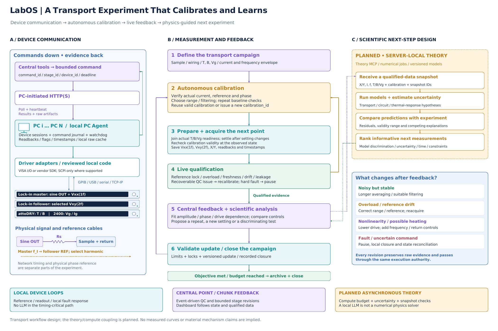

# LabOS 输运实验闭环：通信、自主校准、实时反馈与理论指导
# LabOS Transport Loop: Communication, Autonomous Calibration, Feedback and Physics Guidance

本文件补充[总体架构及中英讲稿](../System_Architecture/LabOS_Architecture_Presentation_ZH_EN.md)，重点讲清实验真正怎样运行、怎样校准，以及根据什么调整下一步。可先使用第 1 节作简短介绍，再按第 2 或第 3 节进行约 10–15 分钟的报告；技术问答可查后面的表格与模型说明。

This companion to the [architecture presentation](../System_Architecture/LabOS_Architecture_Presentation_ZH_EN.md) explains execution, calibration and the evidence behind experimental revisions. Use Section 1 for a short introduction and Section 2 or 3 for an approximately 10–15 minute presentation. Later sections provide technical detail for discussion.

本文描述自主输运闭环的设计流程。**服务器本地理论计算耦合明确列为计划模块**；其他步骤也按其设计职责讲解，不把架构图当作真实仪器验收记录。所有实验分支均为条件示例，不是材料实测结果。

This is a transport workflow design. **Server-local theory/compute coupling is explicitly planned.** The other steps describe their intended responsibilities rather than a physical-instrument acceptance result. The experimental branches are conditional examples, not measured material data.

配套文件 / Figure files: [PDF](LabOS_Transport_Closed_Loop_EN.pdf) · [Editable PPT](LabOS_Transport_Closed_Loop_EN.pptx) · [SVG](LabOS_Transport_Closed_Loop_EN.svg) · [High-resolution PNG](LabOS_Transport_Closed_Loop_EN.png)

## 1. 一分钟介绍 / One-minute introduction

### 中文

这张图展示 LabOS 怎样把输运实验组织成一个可校准、可反馈的闭环。中央把实验目标转成有限操作，通过设备电脑上的驱动与仪器通信；本地程序保留设备会话和原始数据。正式采集前，系统按预定义协议检查实际电流、参考、相位、量程和稳定条件，形成带版本的校准记录。采集过程中，本地处理设备异常，中央根据每个测量点或数据批次的质量，决定延长平均、降低激励、重新校准或增加对照测量。

计划中的下一层，是让服务器上的数值计算加入这个闭环。它接收合格数据及校准信息，比较输运、电路和热效应模型，提出最有区分度的下一组测量。目标是让下一步实验既满足设备与样品约束，也能回答更明确的物理问题。

### English

This figure explains a transport experiment as a calibrated feedback loop. The server translates an objective into bounded operations; local PC drivers communicate with instruments and preserve raw data. Before acquisition, a defined protocol checks actual current, reference, phase, range and settling, producing a versioned calibration record. Local workers handle device faults, while the central loop reviews each point or data chunk and can request more averaging, lower excitation, recalibration or additional controls.

A planned extension brings server-local numerical physics into the loop. It receives qualified data and calibration context, compares transport, circuit and thermal models, and ranks discriminating next measurements. The aim is to choose experiments that remain within the operating envelope and answer a more specific physical question.

## 2. 中文报告讲稿

### 2.1 先把三条路径分清

【指向左侧通信链、中央主流程和右侧虚线框】

上一张架构图说明系统有哪些组成部分；这张图进一步说明它们怎样组织一次输运测量。

左侧是通信与设备执行链。中央是从校准、采集到反馈的实验流程。右上方是计划加入的理论计算，右下方给出不同反馈怎样改变后续操作。

这里有三种不同的时间尺度：仪器内部与本地程序负责设备相关的快速处理；中央在测量点或数据批次之间做质量判断与阶段调整；更耗时的理论计算在服务器异步运行。它们共享状态和证据，但不要求大模型参与每一次设备查询。

### 2.2 设备到底怎样通信

【沿左侧从中央向仪器移动，再沿返回箭头向上】

中央发出的是带设备身份、参数单位、阶段身份和期限的有限操作，例如设置激励、读取状态或采集一个数据批次。设备电脑主动连接中央，通过 HTTP(S) 轮询取得任务，再回传心跳、命令结果和数据文件。

PC Agent 收到任务后，在本地调用经过验证的驱动。驱动可以使用 VISA I/O、厂商 SDK 或既有测试代码；具体设备再通过 GPIB、USB、串口或网络接口连接。VISA 是 I/O 软件层，SCPI 是部分仪器采用的命令语言，它们不能与物理接口混为一谈，也不能假设每台设备都接受同一种命令。

驱动需要核对设备身份与会话，设置参数后读取实际值，处理完成状态、超时和错误，再把结果还原成统一单位。长时间采集也应保留独立的状态监控与本地数据保存。网络恢复时可以补传已保存的数据，而结果不明确的物理动作需要先核对，不能直接重发。

图中最下面的线代表另一类连接：锁相的物理参考和样品激励回路。网络传递计划与数据，参考线传递相位基准。

*通信接口背景：[PyVISA 官方通信说明](https://pyvisa.readthedocs.io/en/latest/introduction/communication.html)。这里不预设用户锁相的具体型号或 attoDRY 的编程接口。*

### 2.3 Autonomous calibration 具体做什么

【指向步骤 2】

自主校准在这里指：按已定义的参考与校准协议，自动检查测量链、调整允许的软件设置、重复参考测量，并判断是否达到接受条件。

对这套输运装置，首先要检查锁相的参考、谐波和读出约定。电流来自锁相正弦输出与串联电阻，但样品电流应由电阻上的实测电压标定，不能直接把输出电压当作样品电流。这个检查可以作为独立校准阶段，复用现有读出路径。

随后，系统建立零激励或参考条件下的背景，选择合适量程和滤波，等待设置变化后的响应稳定，再重复参考点。相位校准要基于已知参考；对于未知的横向二次谐波，保留完整 X/Y 和相位，不能以强制某个分量归零来定义它的物理相位。

通过校准后，系统保存 calibration_id、原始参考数据、校准关系、适用设置与接受结果。改动频率、量程、接线或影响电流加载的条件后，再判断原校准是否仍然适用。这样校准成为实验记录的一部分，而不是一次不留记录的按钮操作。

只有两台输运锁相时，电流标定、Vxx/Vxy 主测量和其他谐波检查可以分阶段完成。自动软件流程只覆盖已配置的电连接；需要改变物理接线时，使用明确的操作者步骤或已验证的切换装置。

校准循环还需要重试、时间和激励预算。不收敛时保存失败原因并暂停，而不是无限调整参数直到得到期望读数。

*锁相相位、自动量程与滤波响应可参考厂商手册，例如 [SRS SR830 manual](https://www.thinksrs.com/downloads/PDFs/Manuals/SR830m.pdf)。该手册用于说明通用测量问题，不代表此装置使用 SR830，也不把其中参数直接用于样品。*

### 2.4 中央怎样看到反馈，并调整实验

【指向步骤 3–6 和右下角动作表】

每个测量点或数据批次返回时，中央应同时收到数据与质量上下文：实际温度、磁场、栅压与漏电，锁相的参考状态和过载标志，量程、滤波、时间窗口，以及使用了哪份校准。

设置环境后、正式采集前，还要按实际状态重新判断校准是否适用；依赖样品加载的电流标定应在相应条件下完成或复查。

界面可以持续显示请求值与实际值、当前阶段、最近更新时间、质量标志、拟合结果和下一步建议。确定性规则先处理可以明确判断的问题，分析程序再计算重复性、漂移与不确定度，中央 Agent 在适当的点或批次边界组织下一阶段。

例如，信号很弱但参考稳定时，可以在允许范围内增加平均并重新评估漂移；如果过载，就调整量程并重新等待稳定；如果高激励下出现可疑漂移或非线性，先降低激励、返回参考点，再补充对照。涉及故障、漏电越界或命令结果不明确时，则暂停并核对状态。

每次调整都形成新的阶段版本，重新检查参数、资源占用和校准有效性，再执行。原始数据保留，拒绝数据也有原因。这样可以解释“系统看到了什么、改了什么、为什么改”，也避免把一个正在执行的命令悄悄改写。

当预定义目标和必要对照已满足，或者时间、激励等预算耗尽，流程转为归档与受控收尾，并记录结束原因。

### 2.5 用非线性 Hall 给出一轮具体过程

【沿中央流程走一遍】

例如，我们希望在给定温度、磁场和栅压下，测量横向二次谐波随电流的变化。

第一轮先做电流、参考与背景检查，再用较低激励采集 Vxx 的基频和 Vxy 的二次谐波。记录实际 RMS 电流、各锁相 X/Y、相位、量程和环境读回。随后在允许的电流范围内取得多个点，并返回一个参考点检查漂移。

如果重复点稳定但噪声较大，下一阶段增加平均；如果高电流点同时伴随纵向响应或参考点的变化，下一阶段降低最大电流并检查恢复情况。对于可靠的二次谐波数据，可以拟合电流平方项，但平方依赖本身不足以区分本征非线性响应、热效应或某些电路贡献。

因此，下一轮有价值的问题可能是：改变频率后幅度和相位怎样变化？降低激励后参考点是否恢复？换一个谐波配置、温度或栅压能否区分解释？这个过程体现了质量反馈与科学判断的配合。

*物理背景：[Sodemann–Fu 理论](https://arxiv.org/abs/1508.00571)、[Ma 等人的非线性 Hall 实验](https://arxiv.org/abs/1809.09279)。实验对照和模型选择仍需结合具体材料与测量链。*

### 2.6 计划中的理论计算怎样指导下一步

【指向右上方 PLANNED 框】

下一步计划，是把服务器上的数值计算接入同一条证据链。Agent 可以提出计算任务，但真正求解模型的是经过定义的数值程序，而不是把大模型的文字回答当作计算结果。

我们可以先接入成本较低的输运拟合、等效电路与电热响应模型。对于合适的材料，再接入能带、Boltzmann、Kubo 或基于 Wannier 模型的计算。每个模型需要说明适用条件、输入参数、到实验观测量的映射和不确定度。

例如，两类模型都可能给出电流平方依赖，但对频率、相位、温度或栅压变化的预测不同。计算模块可以在允许参数空间内寻找预测差异较大、测量噪声可分辨且耗时合理的候选点，再交给中央分析与规划。

理论任务使用带版本的数据快照异步运行，并返回模型版本、收敛情况、预测与候选排序。中央在采纳结果前核对样品、接线和校准上下文是否仍然适用，候选点也仍经过同一个执行协调器。

这样，LabOS 形成三层闭环：先确认测量链可靠，再根据数据质量调整采集，最后用可检验的物理模型选择更有解释力的下一步实验。

## 3. English presentation script

### 3.1 Separate the three paths

[Point to the communication stack, central workflow and dashed theory panel.]

The architecture figure explains the components of LabOS. This figure explains how they organize a transport measurement.

The left column describes communication and local execution. The center follows calibration, acquisition and feedback. The upper-right panel is the planned theory service, while the lower-right panel shows how observations change the next action.

There are three timescales. Instruments and local workers handle device-related fast responses. The central loop evaluates points or chunks and revises stages. More expensive numerical calculations run asynchronously on the server. They share state and evidence without requiring an LLM for every instrument query.

### 3.2 Explain instrument communication

[Follow the left column down to the instruments and back through the return path.]

The server requests bounded operations with device identity, parameter units, stage identity and a deadline: for example, set excitation, read status or acquire a chunk. Instrument PCs initiate HTTP(S) requests, poll for tasks and upload heartbeats, results and artifacts.

The local worker calls a reviewed driver using VISA I/O, a vendor SDK or existing tested code. Instruments connect through GPIB, USB, serial or a network interface. VISA is an I/O software layer; SCPI is a command language used by some instruments. These are distinct from physical interfaces, and support is device-specific.

The adapter verifies identity and session state, reads back settings, checks completion and handles errors and timeouts. Long acquisitions retain independent monitoring and local raw-data storage. Saved artifacts can be synchronized after reconnection; an uncertain physical command must be reconciled before another action is issued.

The physical lock-in reference and sample drive circuit are separate connections. The network carries tasks and data; reference cables establish phase.

*Communication reference: [official PyVISA documentation](https://pyvisa.readthedocs.io/en/latest/introduction/communication.html). No lock-in model or attoDRY programming interface is assumed here.*

### 3.3 Explain autonomous calibration

[Point to Step 2.]

Here, autonomous calibration means following a defined reference protocol, adjusting allowed settings, repeating reference measurements and deciding whether the measurement chain meets acceptance criteria.

For this setup, the protocol verifies reference, harmonic and readout conventions. A lock-in sine output drives the sample through a series resistor, but actual current is calibrated from the measured resistor voltage. That check can be a dedicated stage using an existing readout path.

The workflow then establishes background, chooses range and filtering, waits for settling after changes and repeats reference points. Phase calibration uses a known reference. An unknown transverse second-harmonic signal retains its full X/Y and phase; automatically rotating a component to zero is not a valid way to establish its physical phase.

A successful calibration produces a calibration_id, raw reference data, conversion factors, applicability conditions and an acceptance record. Changes in frequency, range, wiring or loading trigger a validity assessment. With two transport lock-ins, current calibration, the main Vxx/Vxy acquisition and additional harmonic checks can be separate stages. Software automation covers the configured wiring; physical changes use an explicit operator step or a validated switching system.

Calibration also has retry, time and excitation budgets. Nonconvergence records a reason and pauses instead of adjusting indefinitely until a preferred reading appears.

*For an instrument-specific example of phase, range and filter behavior, see the [SRS SR830 manual](https://www.thinksrs.com/downloads/PDFs/Manuals/SR830m.pdf). This is a reference, not an identification of the user's instruments.*

### 3.4 Explain live feedback and revisions

[Point to Steps 3–6 and the action table.]

Each returned point or chunk includes both measurements and quality context: actual temperature, field, gate voltage and leakage; reference and overload flags; range, filter, acquisition interval and calibration identity.

After preparing the environment and before acquisition, calibration validity is reassessed at the observed state. Loading-dependent current calibration is performed or rechecked under the applicable conditions.

The dashboard can show requested and observed states, freshness, quality, fits and the proposed next action. Deterministic rules handle explicit faults first. Analysis computes repeatability, drift and uncertainty. The central agent organizes the next stage at an appropriate point or chunk boundary.

A weak but stable signal may justify additional averaging within the approved settings. Overload calls for range correction and settling. Possible heating or drive-dependent drift calls for lower excitation, a return reference and additional controls. Faults, excessive leakage or uncertain command outcomes require pause and reconciliation.

Each change becomes a new stage version with parameter, resource and calibration checks. Raw data and rejection reasons remain available. The record therefore explains what was observed, what changed and why, rather than silently modifying a running command.

When the predefined objective and required controls are satisfied, or a time/excitation budget is reached, the workflow archives evidence, performs controlled closure and records the reason for ending.

### 3.5 Walk through nonlinear Hall transport

[Follow the central loop once.]

Suppose the objective is to measure transverse second-harmonic voltage versus current at a selected temperature, field and gate voltage.

The first stage checks current, reference and background, then records fundamental Vxx and second-harmonic Vxy at low excitation. It retains actual RMS current, X/Y, phase, range and environmental readbacks. A series of allowed drive amplitudes is followed by a return reference.

If repeated points are stable but noisy, the next stage can use more averaging. If high-drive points also change the longitudinal response or return reference, the next stage can reduce maximum current and check recovery. Qualified second-harmonic data can be fitted against current squared, but that scaling alone does not distinguish intrinsic nonlinear response, heating and some circuit effects.

The next useful question may concern frequency-dependent amplitude and phase, recovery at lower drive, another harmonic configuration, temperature or gate dependence. This connects acquisition quality to scientific decision-making.

*Physics context: [Sodemann–Fu](https://arxiv.org/abs/1508.00571) and [Ma et al.](https://arxiv.org/abs/1809.09279). Controls and model selection remain specific to the material and measurement chain.*

### 3.6 Explain the planned numerical-physics coupling

[Point to the PLANNED panel.]

The planned extension brings server-local numerical calculations into the evidence loop. An agent requests a computation, while a defined numerical program performs the calculation. A local LLM is not itself a numerical physics solver.

The first models can be inexpensive transport fits, equivalent circuits and electrothermal responses. Material-specific band, Boltzmann, Kubo or Wannier-based calculations can follow where their inputs and applicability are established. Each model needs an explicit mapping to measured observables and an uncertainty estimate.

Two models may both predict current-squared scaling while predicting different frequency, phase, temperature or gate responses. Computation can identify candidate conditions with resolvable prediction differences, reasonable acquisition cost and allowed settings. These candidates return to the central analysis and planning loop.

Jobs run asynchronously on versioned snapshots and return model identity, convergence, predictions and candidate rankings. Before using a result, the server checks that sample, wiring and calibration context remain applicable. Candidate actions still pass through the same execution coordinator.

The resulting design has three connected loops: validate the measurement chain, adapt acquisition from quality evidence, and choose scientifically informative measurements using testable physical models.

## 4. 通信链路与消息内容 / Communication layers and messages

| 层次 / Layer | 接口与内容 / Interface and content | 需要区分的事实 / Key distinction |
| --- | --- | --- |
| 科学工具层 / Scientific tool layer | Skill 指导方法；MCP/API 提交有限能力请求 / Skills guide procedures; MCP/API exposes bounded capabilities | 工具请求不直接变成任意设备字符串 / A tool request does not directly become arbitrary device commands |
| 中央—PC / Server–PC | PC 主动 HTTP(S)：注册、心跳、轮询、结果、原始文件 / PC-initiated HTTP(S): registration, heartbeat, poll, results, artifacts | 命令下行表示载荷方向，不要求 PC 入站服务 / Downward payloads do not require inbound PC services |
| 本地驱动 / Local adapter | VISA I/O、厂商 SDK、串口库或已有封装 / VISA I/O, vendor SDK, serial library or reviewed wrapper | VISA 是软件接口；SDK 能力由设备决定 / VISA is a software interface; SDK capabilities are device-specific |
| 设备链路 / Device link | GPIB、USB、串口、TCP/IP；设备支持时使用 SCPI / GPIB, USB, serial, TCP/IP; SCPI where supported | 介质、I/O API 和命令语言是不同层 / Medium, I/O API and command language are distinct layers |
| 物理信号 / Physical signals | Sine OUT、样品电流与电压、参考线、硬件触发 / Sine output, sample current/voltage, references and triggers | 相位和严格同步不由 HTTP(S) 提供 / HTTP(S) does not provide phase or strict synchronization |

**一次请求的完整过程 / One complete request:**

1. 中央检查操作名、设备归属、参数、单位和阶段版本。 / Validate operation, ownership, parameters, units and stage version.
2. 命令保存后，由对应 PC 轮询取得；本地确认会话与期限。 / Persist the command; the assigned PC polls and checks session and deadline.
3. 驱动按设备协议设置并查询完成状态或实际读回。 / Execute the device-specific operation and query completion or readback.
4. 本地先保存原始采集，再分别返回命令结果和数据文件。 / Save raw acquisition locally; return command outcome and artifacts separately.
5. 中央校验身份、校验和及质量上下文，再更新实验状态和界面。 / Verify identity, checksum and quality context before updating state and display.

查询终止符、串口参数、错误队列与完成判据由对应设备手册规定；不把 `*IDN?`、`*OPC?` 或复位命令当成所有设备通用的协议。协议背景见 [PyVISA communication](https://pyvisa.readthedocs.io/en/latest/introduction/communication.html)。

Termination, serial settings, error handling and completion criteria follow the device manual. Commands such as `*IDN?`, `*OPC?` or reset are not assumed universal. See [PyVISA communication](https://pyvisa.readthedocs.io/en/latest/introduction/communication.html).

## 5. 自主校准应包含的检查 / Autonomous calibration checks

| 检查 / Check | 动作 / Action | 保存与接受依据 / Record and acceptance basis |
| --- | --- | --- |
| 配置身份 / Configuration identity | 核对设备、接线、量程、谐波与输入方式 / Verify devices, wiring, range, harmonic and input mode | setup/wiring 版本、设备与驱动身份 / Setup/wiring version, device and driver identities |
| 实际电流 / Actual current | 在专用校准阶段测 Rs 上电压，建立输出到电流的映射 / Measure the resistor voltage in a dedicated calibration stage | Rs 与不确定度、频率、RMS/peak 约定及参考数据 / Rs and uncertainty, frequency, amplitude convention and references |
| 参考与相位 / Reference and phase | 检查物理参考与谐波；用已知参考校验相位链 / Check physical reference/harmonic and phase against a known reference | X/Y、相位、参考状态；分别说明各谐波适用性 / X/Y, phase, reference state and harmonic-specific validity |
| 背景与噪声 / Background and noise | 零激励/参考条件采集，重复估计噪声与漂移 / Acquire background and repeats to assess noise and drift | 保留背景原始数据及处理方式 / Retain raw background and processing method |
| 量程、滤波与稳定 / Range, filter and settling | 调整允许设置后等待，并验证读数稳定 / Adjust allowed settings, wait and verify stable readout | 实际量程、时间常数、滤波阶数、稳定窗口 / Actual range, time constant, filter order and settling window |
| 返回参考与有效性 / Return reference and validity | 复测参考，检查新状态是否仍在校准适用范围 / Repeat a reference and assess validity under the new state | calibration_id、适用域、残差、接受/重测原因 / Calibration identity, validity domain, residuals and acceptance/retest reasons |

### 5.1 电流标定的含义 / Meaning of current calibration

在纯电阻近似适用、读出加载已评估时：

When a resistive approximation is valid and measurement loading has been assessed:

$$
I_{\mathrm{rms}}=\frac{V_{R_s,\mathrm{rms}}}{R_s}.
$$

若频率相关阻抗或寄生效应不可忽略，应使用相应复阻抗关系并保留幅相。Rs 与电压测量的不确定度需要进入电流不确定度；“把串联电阻写进配置”本身不等于完成了标定。

Use the corresponding complex impedance relation when frequency dependence or parasitics matter, preserving amplitude and phase. Resistor and voltage uncertainties contribute to current uncertainty; entering a nominal resistor value is not itself a calibration.

两台锁相不能在单解调条件下同时提供所有样品通道和独立 Rs 读出。这里使用专用校准阶段；它与主测量的接线关系、加载变化和校准有效性要有记录。

Two single-demodulator lock-ins do not provide all sample channels and an independent resistor channel simultaneously. Dedicated calibration stages retain their wiring, loading and validity relationship to the main acquisition.

### 5.2 自主设置与计量校准的区别 / Setup adjustment versus metrological calibration

自动量程、滤波选择和背景检查属于测量链设置与验证。绝对电压增益、温度计或电阻的计量校准，需要已知参考、校准记录及不确定度；软件不能凭空产生这些依据。

Autoranging, filtering and background checks tune and validate the acquisition setup. Absolute voltage gain, thermometer or resistor calibration requires known references, records and uncertainty; software does not create that reference basis by itself.

1f 的相位检查不自动证明 2f 检测链的相位校准。对未知 Vxy(2f)，保持原始 X/Y、参考相位和响应约定；只有存在适用的参考测量时才应用相应校正。滤波改变后重新等待，等待条件要符合实际滤波器，而不固定为一个通用倍数。参考 [lock-in manual](https://www.thinksrs.com/downloads/PDFs/Manuals/SR830m.pdf)。

A 1f phase check does not automatically calibrate a 2f detection path. Retain raw X/Y, reference phase and conventions for unknown Vxy(2f), applying corrections only when an applicable reference supports them. Filter changes require settling appropriate to the actual filter rather than a universal multiplier. See the [instrument manual example](https://www.thinksrs.com/downloads/PDFs/Manuals/SR830m.pdf).

自动调相改变的是 X/Y 坐标和参考相位，通常不改变幅值 R；对未知信号反复调相会丢失原有相位及有符号比较的依据。自动 offset 则可能减去信号本身。这些功能的调用必须属于明确的参考协议，而不是用来让数据符合预期。

Auto-phase changes the X/Y coordinate frame and reference phase, usually preserving magnitude R. Repeatedly rephasing an unknown response removes the basis for its original phase and signed comparison. Auto-offset may subtract the response itself. Their use must belong to a defined reference protocol rather than make data match an expectation.

## 6. 实时反馈怎样变成下一步动作 / Turning feedback into actions

| 反馈 / Observation | 下一步 / Next action | 执行要求 / Execution requirement |
| --- | --- | --- |
| 噪声高、读数稳定 / Noisy but stable | 增加平均或选择合适滤波 / More averaging or suitable filtering | 重算稳定等待，检查漂移与时间预算 / Reassess settling, drift and time cost |
| 过载 / Overload | 纠正量程或降低输入，再采集 / Correct range or reduce input, then reacquire | 拒绝本次不合格数据，保留原始记录 / Reject the affected reading while retaining raw data |
| 参考丢失或相位漂移 / Reference loss or phase drift | 恢复参考并复测校准 / Restore reference and repeat checks | 参考有效后再释放采集 / Acquire only after reference validity is restored |
| T/B/Vg 尚未稳定 / T/B/Vg not settled | 等待或按超时策略暂停 / Wait or pause under timeout policy | 使用实际读回与时间窗口 / Use actual readbacks and timestamps |
| 高电流伴随漂移或可能发热 / Drive-dependent drift or possible heating | 降低电流、返回参考、增加频率等对照 / Lower drive, return to reference and add controls | 不以增大电流作为改善 SNR 的默认动作 / Do not default to more current for better SNR |
| 栅漏电越界或设备故障 / Leakage limit or device fault | 本地受控停止，中央暂停 / Local controlled stop and central pause | 收尾遵守该设备策略，不统一假设磁场/栅压立即归零 / Follow device-specific closure rather than assuming immediate zero field/gate |
| 命令结果不明确 / Uncertain command outcome | 核对会话、归属和物理状态 / Reconcile session, ownership and physical state | 不盲目重发 / No blind replay |
| 拟合不确定度或模型分歧大 / Large fit uncertainty or model disagreement | 重复点、补对照或选择区分点 / Repeat, add a control or choose a discriminating point | 区分测量误差、漂移和模型不足 / Distinguish measurement error, drift and model inadequacy |

**界面应该展示 / Suggested dashboard content:** 当前 run/stage/point、请求值与实际值、数据新鲜度、设备/参考状态、有效与拒绝计数、校准身份、拟合及不确定度、最近一次调整原因、下一阶段待执行的已校验配置。 / Current run/stage/point, requested versus observed state, freshness, device/reference status, qualification counts, calibration identity, fits and uncertainty, reason for the last revision and the validated next-stage configuration.

“实时”在中央侧指随事件或数据批次更新，并在明确的阶段边界作出调整，不承诺硬实时网络延迟。一次长采集期间，本地监控不能被模型调用或上传阻塞；设备读写仍由驱动按会话顺序串行化或采用设备允许的并发方式。

Central “live” feedback means event- or chunk-driven updates and revisions at explicit boundaries, not a hard real-time network guarantee. Local monitoring must remain independent of model calls and uploads; driver access respects session ordering and supported concurrency.

## 7. 计划模块：理论与实验共同选择下一步 / Planned theory-in-the-loop module

### 7.1 接口与任务 / Interface and jobs

计划通过服务器上的 Theory MCP 或等价有限 API，调用预先定义的计算程序。候选任务包括 / A planned Theory MCP or equivalent bounded API can invoke defined numerical jobs such as:

- 输运数据拟合与误差传播 / Transport fitting and uncertainty propagation.
- 电路传递函数与电热响应计算 / Circuit transfer and electrothermal-response calculations.
- 材料适用的 Boltzmann/Kubo、能带或 Wannier 模型 / Material-appropriate Boltzmann/Kubo, band or Wannier models.
- 参数后验/模型比较、候选测量排序 / Parameter inference, model comparison and candidate ranking.

Agent 使用的语言模型仍可在云端与服务器本地后端之间切换；这些语言模型与执行上述数值计算的求解器是不同组件。 / Agent inference may still switch between cloud and server-local LLMs; these language models are distinct from the numerical solvers executing these jobs.

数值任务应报告模型版本、参数、单位、边界条件、收敛情况、预测与不确定度。模型输出经过实验几何、相位和读出约定映射后才能与测量比较。栅压到载流子密度、晶体方向到接线方向的关系，也属于这个映射。

Jobs report model version, parameters, units, boundary conditions, convergence, predictions and uncertainty. Comparison requires a mapping through geometry, phase and readout conventions, including gate-to-density and crystal-to-contact relationships where relevant.

### 7.2 一个有用但有限的诊断模型 / A useful but limited diagnostic model

在固定状态与约定下，可先对复数读出拟合 / At a fixed state and convention, begin with a complex-readout fit:

$$
\widetilde V_{xy,2f}=c_2\,I_{\mathrm{rms}}^2+b.
$$

其中复数表示保留 X/Y 或等价幅相，c2 是当前几何与约定下的经验系数，不能直接等同于材料的 Berry 曲率偶极或非线性电导张量。以 X/Y 拟合还能避免把低 SNR 下的正幅值偏置误当作有符号响应。

The complex quantity retains X/Y or equivalent amplitude and phase. Here c2 is an empirical coefficient for the geometry and conventions, not directly a Berry-curvature dipole or nonlinear-conductivity tensor. Fitting X/Y also avoids interpreting positive-magnitude bias at low SNR as a signed response.

平方项本身不能唯一决定机理。一个**仅用于候选对照设计**的简单热响应模型可以包含 / Quadratic scaling does not identify the mechanism. A simple thermal response used **only to design candidate controls** might include:

$$
H_{\mathrm{th}}(2\omega)=\frac{1}{1+i\,2\omega\tau_{\mathrm{th}}}.
$$

这只是带适用条件的唯象模型。电路滤波、接触与电子弛豫也可能产生频率和相位依赖，所以应把读出传递函数与竞争解释一起比较；不能用“有频率依赖”直接证明发热，或用“无频率依赖”单独证明某种本征机制。以上模型是本方案提出的工作模型，不是对现有数据的拟合结果。

This is a conditional phenomenological model. Electronics, contacts and electronic relaxation can also produce frequency and phase dependence, so the readout transfer function and competing explanations must be considered together. Frequency dependence alone proves neither heating nor an intrinsic mechanism. These are proposed working models, not fits to existing data.

非线性 Hall 的理论与实验背景见 [Sodemann–Fu](https://arxiv.org/abs/1508.00571) 和 [Ma et al.](https://arxiv.org/abs/1809.09279)；频率、纵向与高电流对照的具体材料示例见 [Giant Berry curvature dipole density in a ferroelectric Weyl semimetal](https://www.nature.com/articles/s41535-022-00512-z)。这些文献的材料参数和阈值不直接迁移到本装置。

For context, see [Sodemann–Fu](https://arxiv.org/abs/1508.00571), [Ma et al.](https://arxiv.org/abs/1809.09279) and the material-specific controls in [this experimental study](https://www.nature.com/articles/s41535-022-00512-z). Their parameters and thresholds are not transferred to this setup.

### 7.3 怎样选择“下一点” / Choosing the next point

候选条件可以包含 I、f、T、B、Vg、谐波模式、平均与返回参考。先过滤允许范围与设备状态，再比较 / Candidates can vary I, f, T, B, Vg, harmonic mode, averaging and return references. Filter by allowed settings and device state before considering:

1. **科学区分度 / Scientific discrimination:** 哪些点使竞争模型的预测差异相对测量不确定度更大？ / Where are competing predictions most distinguishable relative to measurement uncertainty?
2. **参数约束能力 / Parameter information:** 哪些点能够缩小关心参数的不确定度？ / Which points can reduce uncertainty in the parameters of interest?
3. **实验成本 / Experimental cost:** 变温、变场、校准与稳定等待需要多少时间？ / What is the cost of temperature/field changes, calibration and settling?
4. **适用域 / Applicability:** 模型、校准和样品状态是否覆盖该候选点？ / Does the candidate lie within model, calibration and sample-state validity?

这些指标可以形成候选排序，而不是只追求最大电压。若模型间差异低于噪声，可能先改善测量或补参考；若所有模型都系统性失配，应扩大诊断与模型集合，而不是强行把实验解释成已有理论。

These criteria rank useful measurements rather than maximizing voltage. If predicted differences are below noise, improve acquisition or references first. If all models show systematic mismatch, expand diagnostics and the model set instead of forcing agreement.

理论与实验共同更新的研究思路可参考 [Bayesian Conavigation](https://doi.org/10.1021/acsnano.4c05368)。LabOS 的输运耦合流程是本方案的计划设计，不声称复现该工作的装置或算法结果。

The research direction of joint theory/experiment updating is illustrated by [Bayesian Conavigation](https://doi.org/10.1021/acsnano.4c05368). The LabOS transport coupling proposed here does not claim reproduction of that apparatus or its results.

### 7.4 异步计算与版本一致性 / Asynchronous computation and consistency

| 项目 / Item | 要保存的内容 / Record |
| --- | --- |
| 数据快照 / Data snapshot | snapshot_id、测量身份及原始文件摘要 / Snapshot identity, measurement identities and raw-artifact hashes |
| 实验上下文 / Experimental context | sample、wiring、calibration_id、实际 T/B/Vg 与时窗 / Sample, wiring, calibration, observed state and time windows |
| 模型任务 / Model job | 模型/代码版本、参数、单位、计算预算和收敛状态 / Model/code version, parameters, units, budget and convergence |
| 预测与建议 / Prediction and proposal | 观测量预测、不确定度、适用域、候选点和排序理由 / Observable predictions, uncertainty, validity, candidates and ranking rationale |
| 采纳记录 / Adoption record | 使用了哪份快照和建议、通过哪些校验、新阶段版本 / Which snapshot/proposal was used, validation and the resulting stage version |

计算期间实验可以执行预先允许的参考或基础阶段。计算结果返回时，需要评估它是否仍适用于当前样品与配置；旧快照结果保留为历史，不直接覆盖正在运行的设置。模型不收敛或超出预算时记录失败，不伪造预测。

While computation runs, the experiment may execute permitted reference or baseline stages. Returned results are checked against current context; older results remain historical and do not overwrite active settings. Nonconvergence and exhausted computation budgets are recorded rather than replaced with invented predictions.

## 8. 一轮条件示例 / One conditional iteration

| 阶段 / Stage | 测量或判断 / Measurement or assessment | 下一步 / Next step |
| --- | --- | --- |
| A | 检查 Rs、电流、参考、背景与低激励重复点 / Check current, reference, background and low-drive repeats | 形成校准记录，进入有限电流序列 / Record calibration and start a bounded current series |
| B | 采集多个 I 点的 Vxx(1f)、Vxy(2f) 与 X/Y / Acquire Vxx(1f), Vxy(2f) and X/Y at several currents | 检查噪声、过载与返回参考 / Check noise, overload and a return reference |
| C | 若稳定但噪声高 / If stable but noisy | 增加平均并重测参考 / Increase averaging and repeat the reference |
| D | 若高激励伴随参考漂移 / If high drive changes the reference | 降低最大激励，检查恢复与纵向响应 / Lower maximum drive and assess recovery and longitudinal response |
| E | 若平方依赖可靠，但机理仍不区分 / If quadratic response is reliable but mechanisms remain ambiguous | 计划模块比较频率、相位、温度等预测 / Planned computation compares frequency, phase and temperature predictions |
| F | 若某个允许频率使竞争预测可分辨 / If an allowed frequency gives distinguishable predictions | 校验该频率下的电流与检测链，再采集 / Validate current/readout at that frequency, then acquire |
| G | 新数据支持或反驳某个预测 / New data support or challenge a prediction | 更新模型/诊断，保留返回参考，再规划下一阶段 / Update models/diagnostics, retain references and plan the next stage |

该例不假设二阶信号总是按线性 Hall 的磁场反对称方式处理；磁场、晶体方向与接触置换等对照应根据候选机制及样品对称性设计。attoDRY 的温度读回也不自动等于高激励下的电子温度。

Do not impose linear-Hall field antisymmetrization universally on a second-order signal. Field, crystal-orientation and contact controls follow candidate mechanisms and sample symmetry. A cryostat temperature readback is not automatically the electron temperature under drive.

## 9. 报告进展时的口径 / How to describe implementation status

当前仓库已有中央调度、本地执行、心跳/watchdog、命令状态、数据同步与模拟流程的质量/追溯基础。本文进一步定义真实输运的自主校准、批次反馈和下一阶段调整；不能用已有光学模拟验收证明这些输运步骤已通过物理装置验收。服务器理论计算耦合是明确的计划模块。仓库依据见 [实现说明](../../../../docs/QUANTA_IMPROVEMENTS_ZH.md)、[验收记录](../../../../docs/QUANTA_ACCEPTANCE_ZH.md)与[硬件接入](../../../../docs/HARDWARE_ZH.md)。

The repository provides coordination, local workers, heartbeat/watchdog, command state, synchronization and qualification/provenance foundations for simulated workflows. This document further defines transport calibration and adaptive stage feedback; optical-simulation acceptance does not establish physical transport validation. Theory/compute coupling is explicitly planned. See the [implementation notes](../../../../docs/QUANTA_IMPROVEMENTS_ZH.md), [acceptance record](../../../../docs/QUANTA_ACCEPTANCE_ZH.md) and [hardware integration guide](../../../../docs/HARDWARE_ZH.md).

建议汇报表述 / Suggested wording:

> 我们把 LabOS 的执行基础扩展为三层输运闭环设计：测量链自主校准、数据质量驱动的阶段调整，以及计划中的服务器理论计算指导。所有调整都保留证据并经过统一执行校验。
>
> We extend the LabOS execution foundation with a three-level transport workflow design: autonomous measurement-chain calibration, quality-driven stage adaptation and planned guidance from server-local numerical physics. Revisions retain evidence and pass through the same execution checks.

## 10. 参考资料 / References

- [QUANTA](https://arxiv.org/abs/2610.38850)：科学 Agent、测量反馈与独立执行控制的背景 / Context for scientific agents, measurement feedback and a separate control layer.
- [PyVISA communication](https://pyvisa.readthedocs.io/en/latest/introduction/communication.html)：设备会话、查询与通信配置 / Instrument sessions, queries and communication configuration.
- [SRS SR830 manual](https://www.thinksrs.com/downloads/PDFs/Manuals/SR830m.pdf)：相位、自动设置与滤波响应的厂商实例 / A manufacturer example of phase, automatic settings and filters.
- [Sodemann & Fu](https://arxiv.org/abs/1508.00571) · [Ma et al.](https://arxiv.org/abs/1809.09279)：非线性 Hall 理论与实验背景 / Nonlinear Hall theory and experiment.
- [Ferroelectric Weyl-semimetal study](https://www.nature.com/articles/s41535-022-00512-z)：材料特定的非线性输运对照 / Material-specific nonlinear-transport controls.
- [Bayesian Conavigation](https://doi.org/10.1021/acsnano.4c05368)：理论与实验共同更新的研究背景 / Research context for joint theory/experiment updating.

流程图、协议组合、反馈表和候选排序方法是本项目的设计说明；没有复用上述来源的实验数据或材料参数。

The workflow, protocol composition, action table and candidate-ranking proposal are LabOS design material; no source experimental data or material parameters are reused.
